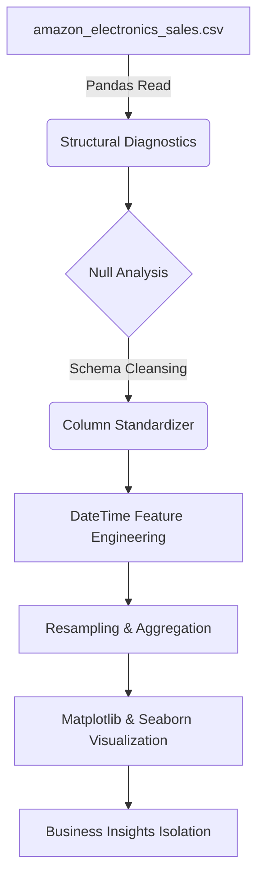

# 📊 E-Commerce & Urban Real Estate Analytics Portfolio

A collection of production-grade, end-to-end data analytics and machine learning pipelines engineered in Python. This portfolio showcases structural data diagnostics, time-series financial engineering, customer lifetime value modeling, and multivariate regression analysis using Scikit-Learn, Pandas, NumPy, Matplotlib, and Seaborn.

---

# 🏡 Module A: Urban Housing Price Predictor

A production-ready **Machine Learning pipeline** evaluating a dataset of urban housing logs (200 rows, 5 columns) to predict property valuations based on property footprints, interior structural components, and neighborhood geospatial elements.

## 🚀 Features
- **Initial Data Evaluation (EDA):** Dynamically computes missingness ratios, cell-by-cell structural integrity metrics, and transposes tabular descriptive summary distribution metrics for improved visibility.
- **Feature Interaction Analysis:** Automatically filters numerical columns to avoid structural data type crashes, evaluates Pearson multicollinearity trends, identifies overlapping predictors crossing safe thresholds (>0.80), and maps custom lower-triangular correlation heatmaps.
- **Robust Pipeline Preprocessing:** Isolates deep data copies to prevent framework mutations, applies rule-based conditional mean/mode statistical imputations, and executes One-Hot Encoding while dropping initial reference levels to circumvent the dummy variable trap.
- **Dual Regression Fitting:** Splits datasets into clean 80:20 train/test partitions, standardizes structural scales via `StandardScaler`, fits an **Ordinary Least Squares (OLS) Linear Regression** baseline, and trains an **L2-Regularized Ridge Regression Model**.
- **Production-Grade Diagnostics:** Exports comparative error breakdowns (MSE and R² performance metrics), evaluates linearity alignments using True vs. Predicted scatterplots, checks error variance assumptions through custom purple homoscedasticity residual maps, and visually ranks standardized feature weights.

## 💻 Installation & Core Execution
Ensure your data science stack dependencies are installed (`pip install pandas numpy matplotlib seaborn scikit-learn`).
```python
import pandas as pd

# Load Raw Data Asset
df_house = pd.read_csv("urban_housing_prices.csv")

# Run complete processing and scaling pipeline
encoded_data = encode_and_impute(df_house)

# Train, evaluate metrics, and extract modeling weights
lm, rm, X_train, y_true, y_pred_lr, y_pred_rm, residuals = train_and_evaluate_models(
    encoded_data, target='Price_ZAR_Thousands'
)
```

## 📈 Diagnostic & Performance Report

### 1️⃣ Model Performance Metrics Comparison
Both models performed exceptionally well, capturing over **94%** of the underlying variance in urban property prices.

| Algorithm Variation | Mean Squared Error (MSE) | Coefficient of Determination (R²) |
| :--- | :---: | :---: |
| **OLS Linear Regression** | 209.32 | 0.9498 |
| **Ridge Regression (L2)** | 213.50 | 0.9488 |

### 2️⃣ Feature Correlation Dynamics
- **`SqFootage` (Square Footage):** Exhibits an exceptionally dominant positive correlation (**+0.84**) with property price, indicating that footprint size is the single most critical driver of high house valuations.
- **`DistToCenter` (Distance to Urban Center):** Displays a pronounced negative linear correlation (**-0.49**) with price, confirming that property valuation drops significantly the further a house is located from the downtown city hub.
- **Multicollinearity Integrity Check:** Internal overlap checks returned scores safely below the **0.80** threshold across all predictor interactions, proving that the independent input vectors do not suffer from damaging structural collinearity risks.

### 3️⃣ Standardized Coefficient Weights Impact
By tracking the final slopes across standardized feature sets, the model ranks feature importance on property pricing in the following sequence:
1. **`SqFootage` (+40.0+ Weight):** The absolute primary predictor for valuation increases.
2. **`DistToCenter` (~ -22.0 Weight):** The primary geographic discount factor.
3. **`Bedrooms` (~ +12.0 Weight):** Secondary structure space validation layer.
4. **`NoiseLevel` (Negligible Impact):** Shows close to zero statistical impact on boundary choices.

### 4️⃣ Homoscedasticity Error Check
Plotting the model residuals against the model's target estimations showed a random distribution of error variations tightly clustered along the horizontal **y=0** balance line. This total absence of distinct shapes or funneling visual distributions mathematically confirms **homoscedasticity**, verifying that the regression modeling pipeline assumptions are statistically valid, non-biased, and safe for development deployments.

---

# 🛒 Module B: Amazon Electronics Store Analytics Pipeline

An end-to-end data diagnostics, processing, and exploratory data analysis (EDA) pipeline built in Python. This project evaluates a production dataset containing **50,000 corporate transaction records** across **26 operational variables** to isolate macroeconomic cycles, calculate elasticity, identify major revenue drivers, and map margin erosion.

## 📊 Pipeline Architecture & Workflow



## 🛠️ Technical Features & Engineering Highlights
* **Automated Schema Sanitization:** Eliminates string spacing and case-sensitivity vulnerabilities by programmatically normalising raw headers.
* **Time-Series Financial Resampling:** Parses raw transaction strings into active DateTime indices, downsampling transaction velocity into month-end (`ME`) and quarter-end (`QE`) financial horizons.
* **Correlative Dependency Matrixing:** Implements Pearson correlation mapping to find explicit dependencies between sales volume, logistics overhead, and profit erosion.
* **Bivariate Density Mapping:** Utilizes high-density Hexbin maps to isolate discrete purchase frequency concentrations against promotional markdown bounds.

## 📂 Code Module Breakdown

### 1. Structural Diagnostics & Schema Sanitization
```python
def df_info(store_df):
    print(store_df.info())

def check_nulls(store_df):
    print(store_df.isnull().any())

def standardize_cols(store_df):
    store_df.columns = store_df.columns.str.lower().str.replace(' ','_')
```
* **Purpose:** Runs a defensive check across data vectors to flag structural missingness (such as `postal_code` null gaps) before programmatically sanitizing messy columns into standard snake_case tokens.

### 2. Chronological Sales Resampling
```python
def monthly_quaterly_sales(store_df):
    store_df["order_date"] = pd.to_datetime(store_df["order_date"], dayfirst=True)
    df_temp = store_df.set_index("order_date")
    monthly_sales = df_temp["sales"].resample("ME").sum()
    quarterly_sales = df_temp["sales"].resample("QE").sum()
```
* **Purpose:** Dynamically changes data resolution into standard fiscal reporting buckets to track market spending ebbs and flows over time.

### 3. Pearson Correlation Heatmap & Bivariate concentration Hex Map
```python
def df_corr(store_df):
    corr_df = store_df.corr(numeric_only=True)

def df_hex(store_df):
    hb = ax.hexbin(store_df["discount"], store_df["quantity"], gridsize=15, cmap="YlOrRd")
```
* **Purpose:** Uncovers hidden margin drivers and operational cost behaviors by calculating mathematical dependencies, and maps overlapping customer demand clusters under different pricing models.

## 📈 Deep-Dive Analytical Insights

### 1. Macro Sales Volatility & Cash Management
* **Cyclical Shocks:** The store is highly susceptible to cyclical demand shocks rather than stable month-over-month expansion. Gross monthly transaction volumes surge around the middle of each year (peaking near **\$540,000**), immediately followed by deep operational contractions dropping down to floors near **\$440,000** in the opening quarters.
* **Business Takeaway:** Cash flow configurations must be managed conservatively during peak mid-year windfalls to safely cushion the predictable, sharp spending pullbacks that follow.

### 2. High-Ticket Pareto Drivers
* **Enterprise Dependencies:** A tiny fraction of enterprise business hardware accounts for a massive proportion of global top-line numbers. The **Canon imageCLASS Copier** and **Cisco Smart Office Phone** are core revenue anchors, generating over **\$4.0 million** each. Premium office furniture occupies the secondary tier around **\$2.4 million**, while smartphones baseline at **\$2.0 million**.
* **Business Takeaway:** Procurement teams must safeguard relationships with these hardware suppliers to ensure uninterrupted inventory flow and prevent critical stockouts.

### 3. Linear Correlation Matrix & Profit Leaks
* **Logistics Overhead:** An absolute correlation coefficient of **1.00** connects gross sales directly to shipping costs, proving that distribution overhead scales identically beside revenue. 
* **Margin Drain:** A heavy negative correlation of **-0.52** links promotional discounts with net profits, proving mathematically that markdown strategies act as the single largest drag on corporate value.
