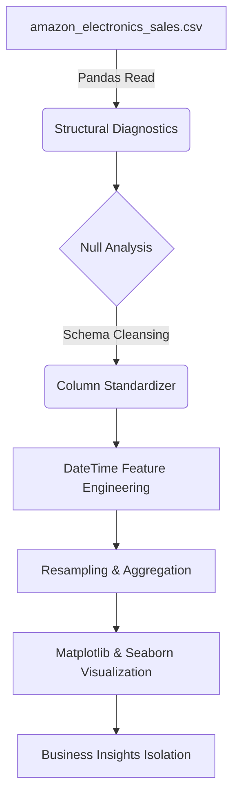

# 📊 E-Commerce & Urban Real Estate Analytics Portfolio

A collection of production-grade, end-to-end data analytics and machine learning pipelines engineered in Python. This portfolio showcases structural data diagnostics, time-series financial engineering, customer lifetime value modeling, and multivariate regression analysis using Scikit-Learn, Pandas, NumPy, Matplotlib, and Seaborn.

---

# 🏡 Module A: Urban Housing Price Predictor

A production-ready **Machine Learning pipeline** evaluating a dataset of urban housing logs (200 rows, 5 columns) to predict property valuations based on property footprints, interior structural components, and neighborhood geospatial elements.

## 🚀 Features
- **Initial Data Evaluation (EDA):** Dynamically computes missingness ratios, cell-by-cell structural integrity metrics, and transposes tabular descriptive summary distribution metrics for improved visibility.
- **Feature Interaction Analysis:** Automatically filters numerical columns to avoid structural data type crashes, evaluates Pearson multicollinearity trends, identifies overlapping predictors crossing safe thresholds (>0.80), and maps custom lower-triangular correlation heatmaps.
- **Robust Pipeline Preprocessing:** Isolates deep data copies to prevent framework mutations, applies rule-based conditional mean/mode statistical imputations, and executes One-Hot Encoding while dropping initial reference levels to circumvent the dummy variable trap.
- **Dual Regression Fitting:** Splits datasets into clean 80:20 train/test partitions, standardizes structural scales via `StandardScaler`, fits an **Ordinary Least Squares (OLS) Linear Regression** baseline, and trains an **L2-Regularized Ridge Regression Model**.
- **Production-Grade Diagnostics:** Exports comparative error breakdowns (MSE and R² performance metrics), evaluates linearity alignments using True vs. Predicted scatterplots, checks error variance assumptions through custom purple homoscedasticity residual maps, and visually ranks standardized feature weights.

## 💻 Installation & Core Execution
Ensure your data science stack dependencies are installed (`pip install pandas numpy matplotlib seaborn scikit-learn`).
```python
import pandas as pd

# Load Raw Data Asset
df_house = pd.read_csv("urban_housing_prices.csv")

# Run complete processing and scaling pipeline
encoded_data = encode_and_impute(df_house)

# Train, evaluate metrics, and extract modeling weights
lm, rm, X_train, y_true, y_pred_lr, y_pred_rm, residuals = train_and_evaluate_models(
    encoded_data, target='Price_ZAR_Thousands'
)
```

## 📈 Diagnostic & Performance Report

### 1️⃣ Model Performance Metrics Comparison
Both models performed exceptionally well, capturing over **94%** of the underlying variance in urban property prices.

| Algorithm Variation | Mean Squared Error (MSE) | Coefficient of Determination (R²) |
| :--- | :---: | :---: |
| **OLS Linear Regression** | 209.32 | 0.9498 |
| **Ridge Regression (L2)** | 213.50 | 0.9488 |

### 2️⃣ Feature Correlation Dynamics
- **`SqFootage` (Square Footage):** Exhibits an exceptionally dominant positive correlation (**+0.84**) with property price, indicating that footprint size is the single most critical driver of high house valuations.
- **`DistToCenter` (Distance to Urban Center):** Displays a pronounced negative linear correlation (**-0.49**) with price, confirming that property valuation drops significantly the further a house is located from the downtown city hub.
- **Multicollinearity Integrity Check:** Internal overlap checks returned scores safely below the **0.80** threshold across all predictor interactions, proving that the independent input vectors do not suffer from damaging structural collinearity risks.

### 3️⃣ Standardized Coefficient Weights Impact
By tracking the final slopes across standardized feature sets, the model ranks feature importance on property pricing in the following sequence:
1. **`SqFootage` (+40.0+ Weight):** The absolute primary predictor for valuation increases.
2. **`DistToCenter` (~ -22.0 Weight):** The primary geographic discount factor.
3. **`Bedrooms` (~ +12.0 Weight):** Secondary structure space validation layer.
4. **`NoiseLevel` (Negligible Impact):** Shows close to zero statistical impact on boundary choices.

### 4️⃣ Homoscedasticity Error Check
Plotting the model residuals against the model's target estimations showed a random distribution of error variations tightly clustered along the horizontal **y=0** balance line. This total absence of distinct shapes or funneling visual distributions mathematically confirms **homoscedasticity**, verifying that the regression modeling pipeline assumptions are statistically valid, non-biased, and safe for development deployments.

---

# 🛒 Module B: Amazon Electronics Store Analytics Pipeline

An end-to-end data diagnostics, processing, and exploratory data analysis (EDA) pipeline built in Python. This project evaluates a production dataset containing **50,000 corporate transaction records** across **26 operational variables** to isolate macroeconomic cycles, calculate elasticity, identify major revenue drivers, and map margin erosion.

## 📊 Pipeline Architecture & Workflow



## 🛠️ Technical Features & Engineering Highlights
* **Automated Schema Sanitization:** Eliminates string spacing and case-sensitivity vulnerabilities by programmatically normalising raw headers.
* **Time-Series Financial Resampling:** Parses raw transaction strings into active DateTime indices, downsampling transaction velocity into month-end (`ME`) and quarter-end (`QE`) financial horizons.
* **Correlative Dependency Matrixing:** Implements Pearson correlation mapping to find explicit dependencies between sales volume, logistics overhead, and profit erosion.
* **Bivariate Density Mapping:** Utilizes high-density Hexbin maps to isolate discrete purchase frequency concentrations against promotional markdown bounds.

## 📂 Code Module Breakdown

### 1. Structural Diagnostics & Schema Sanitization
```python
def df_info(store_df):
    print(store_df.info())

def check_nulls(store_df):
    print(store_df.isnull().any())

def standardize_cols(store_df):
    store_df.columns = store_df.columns.str.lower().str.replace(' ','_')
```
* **Purpose:** Runs a defensive check across data vectors to flag structural missingness (such as `postal_code` null gaps) before programmatically sanitizing messy columns into standard snake_case tokens.

### 2. Chronological Sales Resampling
```python
def monthly_quaterly_sales(store_df):
    store_df["order_date"] = pd.to_datetime(store_df["order_date"], dayfirst=True)
    df_temp = store_df.set_index("order_date")
    monthly_sales = df_temp["sales"].resample("ME").sum()
    quarterly_sales = df_temp["sales"].resample("QE").sum()
```
* **Purpose:** Dynamically changes data resolution into standard fiscal reporting buckets to track market spending ebbs and flows over time.

### 3. Pearson Correlation Heatmap & Bivariate concentration Hex Map
```python
def df_corr(store_df):
    corr_df = store_df.corr(numeric_only=True)

def df_hex(store_df):
    hb = ax.hexbin(store_df["discount"], store_df["quantity"], gridsize=15, cmap="YlOrRd")
```
* **Purpose:** Uncovers hidden margin drivers and operational cost behaviors by calculating mathematical dependencies, and maps overlapping customer demand clusters under different pricing models.

## 📈 Deep-Dive Analytical Insights

### 1. Macro Sales Volatility & Cash Management
* **Cyclical Shocks:** The store is highly susceptible to cyclical demand shocks rather than stable month-over-month expansion. Gross monthly transaction volumes surge around the middle of each year (peaking near **\$540,000**), immediately followed by deep operational contractions dropping down to floors near **\$440,000** in the opening quarters.
* **Business Takeaway:** Cash flow configurations must be managed conservatively during peak mid-year windfalls to safely cushion the predictable, sharp spending pullbacks that follow.

### 2. High-Ticket Pareto Drivers
* **Enterprise Dependencies:** A tiny fraction of enterprise business hardware accounts for a massive proportion of global top-line numbers. The **Canon imageCLASS Copier** and **Cisco Smart Office Phone** are core revenue anchors, generating over **\$4.0 million** each. Premium office furniture occupies the secondary tier around **\$2.4 million**, while smartphones baseline at **\$2.0 million**.
* **Business Takeaway:** Procurement teams must safeguard relationships with these hardware suppliers to ensure uninterrupted inventory flow and prevent critical stockouts.

* # Wine Quality Classification Pipeline

An end-to-end Machine Learning implementation designed to evaluate and predict wine quality using advanced classification techniques. The architecture integrates a rigorous data preprocessing pipeline, automated hyperparameter optimization via `GridSearchCV`, and comprehensive diagnostic visualization frameworks.

This project forms part of the **Oasis Infobyte Data Analytics Internship** requirements.

---

## 🚀 Core Features & Architectural Workflow

### 1. Ingestion & Structured Preprocessing
* **Dynamic Target Engineering:** Transforms regular wine quality scores into structural labels (`Good` ≥ 6 vs. `Bad` < 6).
* **Stratified Validation Splitting:** Employs an 80/20 train/test split with stratification to maintain exact target distribution across both domains.
* **Feature Variance Standardization:** Scaled feature fields using `StandardScaler` to protect modeling metrics from dimensional bias.

### 2. Multi-Framework Optimization Pipeline
Executes automated parameter space sweeping with 5-Fold Cross-Validation, specifically optimizing for **Macro F1-Score** to balance performance tracking across both target domains:
* **Random Forest Classifier:** Tunes depth, split metrics, and estimator volume.
* **SGD Classifier (Stochastic Gradient Descent):** Tunes structural loss types (`hinge` vs. `log_loss`), regulation penalties (`l1`/`l2`), and learning rates.
* **SVC (Support Vector Classification):** Tunes soft-margin variables (C) and boundary kernels (`linear` vs. `rbf`).

### 3. Diagnostic & Comparative Evaluation
* **Performance Benchmark Matrix:** Consolidated scoring reports comparing multi-model tracking profiles side-by-side.
* **Heatmap Matrix:** Side-by-side execution of annotated validation maps to track true-versus-predicted output paths.
* **Feature Priority Ranking:** Extracts structural importance scores from the top-performing ensemble tree pipeline for domain insights.

---

## 📈 Performance Summary

The model parameters were optimized using cross-validation, resulting in competitive accuracies across all evaluators:

| Model Framework | Accuracy Score | Macro F1-Score |
| :--- | :---: | :---: |
| **Random Forest** | 70.94% | 0.6977 |
| **SGD Classifier** | **71.56%** | **0.7009** |
| **SVC (Support Vector)** | 71.25% | 0.7005 |

---

## 🛠️ Technology Stack & Libraries

* **Core Analysis:** `pandas`, `numpy`
* **Visualization Engine:** `matplotlib`, `seaborn`
* **Machine Learning & Tuning:** `scikit-learn`

---

## 📂 Project Structure

```text
├── uci_wine_quality_red.csv  # Physicochemical properties dataset
├── wine_quality_pipeline.ipynb # Full pipeline implementation notebook
└── README.md                  # Project overview and architecture documentation
```

---

## 🎯 Implementation Steps

1. **Clone the repository:**
   ```bash
   git clone https://github.com
   ```
2. **Ensure all standard numerical and parsing dependencies are loaded:**
   ```bash
   pip install pandas numpy matplotlib seaborn scikit-learn
   ```
3. **Execute the execution loop within your data notebook to run the optimization block:**
   ```python
   # Run full pipeline sequence
   X_tr, X_te, y_tr, y_te = load_and_preprocess_data("uci_wine_quality_red.csv")
   tuned_models = train_and_tune_models(X_tr, y_tr)
   evaluate_and_compare(tuned_models, X_te, y_te)
   ```

# 📊 Unveiling the Android App Market (Google Play Store Ecosystem Analysis)

## 📱 Project Overview & Mobile Architecture
This repository contains a comprehensive data engineering and exploratory data analysis (EDA) pipeline analyzing the **Google Play Store Ecosystem**. The analysis covers data cleaning of real-world datasets, category density discovery, app size vs. install volumetric correlation modeling, financial monetization mapping, and natural language sentiment analysis on user reviews.

> **Note on Workflow Environment:** Due to hardware constraints and limited computer access, this entire data science pipeline—from raw data cleaning to algorithmic sentiment classification—was developed and executed entirely on a mobile device utilizing **Termux**, **Pydroid**, and **Acode**. This environment proves that production-ready Python pipelines can be engineered anywhere with the right terminal setups.

---

## 🛠️ Tech Stack & Dependencies
* **Data Engineering & Analytics:** `Python`, `pandas`, `numpy`
* **Static Visualization:** `matplotlib`, `seaborn`
* **Interactive Visualization:** `plotly.express`, `plotly.graph_objects`
* **Natural Language Processing:** `nltk` (VADER Sentiment Intensity Analyzer)
* **Environment:** Jupyter Notebook / Production Python Script

---

## 🧬 Data Pipeline & Processing Steps

### 1. Robust Data Preprocessing & Structural Engineering
The raw data contained messy real-world anomalies, structural redundancies, and mixed numeric types. The preprocessing pipeline resolved these as follows:
* **Duplicate Mitigation:** Dropped structural duplicates matching the unique `App` signature column, ensuring no data leakage occurred during aggregation.
* **String Disaggregation & Normalization:** Utilized regex logic to clear plus notation flags (`+`) and structural commas (`,`) from the `Installs` column before casting to numeric integers.
* **Currency Engineering:** Stripped out currency identifiers (`$`) from the `Price` vector to transform records into precise numeric floats.
* **Size Scale Unification:** Standardized mixed string metrics (Megabytes `M` and Kilobytes `K`) into a single float column (`Size_MB`), with missing values or "Varies with device" flags gracefully imputed using the feature median.
* **Missing Value Imputation:** Handled missing indices in the `Rating` column dynamically by computing sub-categorical grouping medians (`groupby('Category')`) to preserve distribution integrity.

```python
# Initial Dataset Architecture Input Shapes:
# Apps Table: (1020, 9) | User Reviews Table: (500, 2)
# Final Cleaned Production Matrix Shape: (1000, 10)
```

### 2. Category & Saturated Markets Analysis
Using distribution metrics, the pipeline evaluated market volume across primary categories to identify saturated vs. open fields. 
* **Top 3 Saturated Categories Detected:**
  1. `FAMILY` (225 Apps)
  2. `GAME` (196 Apps)
  3. `TOOLS` (138 Apps)
* **Strategic Takeaway:** High-saturation spaces require massive visibility budgets. Developers looking for higher organic discoverability should target utility sectors like `FINANCE` or `MEDICAL` which display healthy baseline ratings.

### 3. Ratings & Volumetric Distribution Breakdown
* Analyzed overall app rating trends across the market, showing a heavily left-skewed distribution with a market median floating between `4.0` and `4.5`.
* Computed average category ratings to distinguish which functional app designs consistently yield high consumer satisfaction scores.

### 4. App Size vs. Installs (Logarithmic Correlation)
* Mapped a scatter visualization plotting `Size_MB` against `Installs` using a logarithmic Y-axis to visualize exponential download thresholds.
* **Pearson Correlation Metric:** `-0.0474`
* **Insight:** While the broad correlation value is near-neutral, the scatter plot layout exposes a structural ceiling: beyond certain file-size thresholds, the probability of achieving hyper-scale installs decreases sharply, emphasizing the need for lean build sizes.

### 5. Financial & Monetization Models
* **Freemium Dominance:** Free apps represent the overwhelming majority of the market distribution layer (**87.0%** Free vs. **13.0%** Paid).
* **Revenue Estimation Framework:** Computed an Estimated Minimum Gross Revenue metric (Installs × Price) to isolate the top-earning segments. While niche paid software yields steady unit revenue, high-volume download layers scale massively through hybrid inside-app monetization structures.

### 6. Algorithmic Sentiment Diagnostics (NLTK VADER)
Unstructured user text reviews were pushed through the **NLTK VADER (Valence Aware Dictionary and sEntiment Reasoner)** engine. Multi-polarity compound scores were assigned to reviews to classify overall market sentiment:
* **Compound Score Thresholds:**
  * \(\text{Score} \ge 0.05 \longrightarrow\) **Positive** (283 Samples)
  * \(-0.05 < \text{Score} < 0.05 \longrightarrow\) **Neutral**
  * \(\text{Score} \le -0.05 \longrightarrow\) **Negative** (217 Samples)
* Merged sentiment vectors with app categories to map which operational functional fields trigger high friction or exceptional praise from consumers.

---

## 📊 Advanced Visualization Layer

### Hierarchical Interactive Treemap
The repository contains an interactive **Plotly Treemap** dashboard (`interactive_market_matrix.html`). This complex data layer maps three critical parameters simultaneously:
1. **Hierarchical Paths:** Nested by `Category` → `Type` (Free/Paid).
2. **Canvas Volume Size:** Tile area corresponds directly to the total scale of user `Installs`.
3. **Sequential Color Mapping:** Color gradient mapped onto sequential channels (`RdYlGn`), reflecting the precise average `Rating` of that specific market tier.

---

## 💡 Strategic Action Plan for Developers
1. **Target Low-Competition Utility Sectors:** Avoid entering the hyper-saturated `GAME` or `FAMILY` pools unless backed by heavy funding. Focus on utility niches showing resilient consumer ratings.
2. **Keep the Digital Footprint Lean:** Maintain a minimized file footprint size; data indicates high-tier download scaling drops off when storage requirements become excessive.
3. **Deploy Hybrid Freemium Structures:** Lean heavily on free-to-download funnels to scale up user volume vectors, monetizing via ad-networks or premium micro-transactions rather than a strict up-front paywall model.

---

## 🤝 Acknowledgments & Portfolio Network
* **Oasis Infobyte:** For providing this rigorous data analytics internship case-study workspace.
* **ORT South Africa:** For equipping me with the core structural foundation to handle advanced big data architectures and ETL workflows.
* **LinkedIn Update:** Read the professional release brief and journey documentation on my LinkedIn profile.


### 3. Linear Correlation Matrix & Profit Leaks
* **Logistics Overhead:** An absolute correlation coefficient of **1.00** connects gross sales directly to shipping costs, proving that distribution overhead scales identically beside revenue. 
* **Margin Drain:** A heavy negative correlation of **-0.52** links promotional discounts with net profits, proving mathematically that markdown strategies act as the single largest drag on corporate value.
